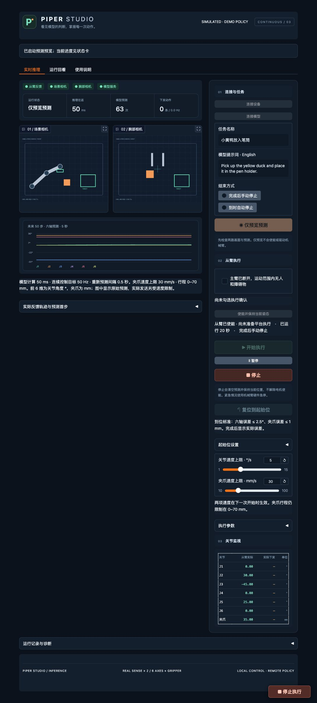
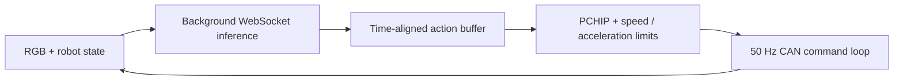

# Piper Realtime VLA

**[English](README.md) | [简体中文](README.zh-CN.md)**

An asynchronous VLA execution runtime for AgileX PiPER. Model requests run in
the background while a separate control loop executes a valid action trajectory.
Time-aligned handoffs and PCHIP interpolation turn 10 Hz action chunks into
continuous 50 Hz commands.



**Platform UI / 平台 UI.** The actual inference interface running with simulated
devices and a demo policy. This screenshot does not show trained-model performance.

For demonstration collection and dataset replay, use
[Piper Studio](https://github.com/1024AILab/piper-studio).


## Real robot setup


User-provided PiPER setup photograph: duck pick-and-place with a pen holder.


## Where the latency improvement comes from

- **Asynchronous inference:** requests do not block the independent control thread.
- **Persistent WebSocket:** reuse the model connection; no replay of failed requests.
- **Lossless PNG transport:** compress two RGB observations when the server advertises support.
- **Continuous trajectories:** align new chunks to monotonic time, retain a short valid prefix,
  blend the transition and interpolate with PCHIP.
- **Bounded execution:** preserve position, velocity, acceleration, freshness and timeout checks.

The optimization reduces communication overhead and stop-and-wait execution.
It does not speed up the model's neural-network computation. The default **50 Hz**
is a control target, not a guarantee of operating-system hard real-time scheduling.



## Run the platform UI

Use Python **3.12** and a separate virtual environment for this repository.
The two Piper repositories retain shared `piper_studio` device-module names;
install them in separate environments.

```bash
git clone https://github.com/1024AILab/piper-realtime-vla.git
cd piper-realtime-vla
python3.12 -m venv .venv
source .venv/bin/activate
python -m pip install -e .
python -m piper_studio.inference_app --sim --connect --port 7862 --open
```

Open **http://127.0.0.1:7862**. Click **仅预览预测** to inspect a demo action
chunk. Simulation is explicitly labelled. The current UI uses Chinese labels.

## Connect a trained policy

The client uses a deliberately narrow protocol. A different model needs an
adapter that preserves these semantics; an arbitrary VLA server is not plug-compatible.

| Field | Required contract |
|---|---|
| Images | `image` + `wrist_image`, 640×480 uint8 RGB |
| State | Seven values; previous executed command |
| Output | Finite absolute targets shaped `(50, 7)` |
| Units | Six joints in 0.001°, gripper in µm |
| Policy rate | 10 Hz action spacing |
| Protocol | OpenPI MessagePack WebSocket + `studio_protocol=1` metadata |

An [OpenPI server adapter](server/README.md) is included. Run it in your existing
GPU training environment with the matching checkpoint, normalization assets,
tokenizer and data transforms. Weights and training datasets are not included.

```bash
# On the GPU computer, in the checkpoint's OpenPI environment:
python /path/to/piper-realtime-vla/server/serve_openpi.py \
  --config piper_duck_lora \
  --checkpoint /path/to/checkpoint \
  --warmup-parquet /path/to/episode_000000.parquet

# On the robot computer:
ssh -N -L 127.0.0.1:8000:127.0.0.1:8000 your-gpu-host
```

The model service and UI bind to loopback. Enter `ws://127.0.0.1:8000` in the UI.
The original deployment scripts are preserved in `server/reference/`; their
machine-specific paths and memory settings need adjustment before reuse.

## Connect physical hardware

```bash
python -m pip install -e '.[mac]'
cp configs/mac_inference.json configs/mac_inference.local.json
```

Set your actual camera USB IDs and CAN adapter in the local config. Start the
RGB bridge with `PIPER_SCENE_SERIAL` and `PIPER_WRIST_SERIAL` set, then launch:

```bash
./启动RealSense彩色流.command
# Separate terminal, with .venv active and the RGB bridge still running:
python -m piper_studio.inference_app --config configs/mac_inference.local.json --connect --open
```

The hardware UI uses **http://127.0.0.1:7861**. Connect devices and the model,
inspect predictions first, then explicitly prepare the follower before execution.
The leader must no longer command the same CAN bus. The hardware emergency stop
must remain reachable. Starting the UI does not arm robot motion.

On Linux, install `.[hardware,realsense]` and configure SocketCAN and camera IDs.
Only one process may own an adapter; disconnect the collection platform first.

## Default execution limits

The table uses `configs/mac_inference.json`; simulation uses a 30 mm/s gripper limit.

| Setting | Default |
|---|---|
| Control / policy frequency | 50 Hz / 10 Hz |
| Observation / replanning interval | 0.5 s, earlier if the buffer is running low |
| Inference age budget | 1.5 s |
| Future buffer after result readiness | Up to 2 s, bounded by the original prediction horizon |
| Handoff | About 0.1 s retained prefix + 0.3 s transition |
| Joint / gripper speed | 5°/s / 50 mm/s |
| Joint / gripper acceleration | 25°/s² / 250 mm/s² |
| Gripper range | 0–70 mm |

Expired trajectories are not extended. A late response cannot restart stopped
motion. The controller also monitors page heartbeat, CAN faults, stale feedback,
camera freshness, following error and missed control deadlines. Pause/stop does
not disable the motors or replace a hardware emergency stop. No collision planner
or automatic task-success detector is included; the default task end is manual.

## Code map and validation

| Path | Purpose |
|---|---|
| `piper_studio/inference.py` | Background inference and control orchestration |
| `piper_studio/inference_stream.py` | Time alignment, PCHIP and bounded chunk handoff |
| `piper_studio/policy_client.py` | Persistent connection and lossless RGB transport |
| `piper_studio/inference_app.py` | Prediction, control and run-review UI |
| `server/serve_openpi.py` | Configurable GPU service adapter |
| `tests/` | Existing interpolation, timeout, transport and device regressions |

```bash
python -m pip install -e '.[test,mac]'  # hardware instead of mac on Linux
python -m pytest -q
```

See [validation](docs/VALIDATION.md) and [third-party notices](THIRD_PARTY_NOTICES.md).
UI screenshots and local regression tests do not establish real-robot task success.
